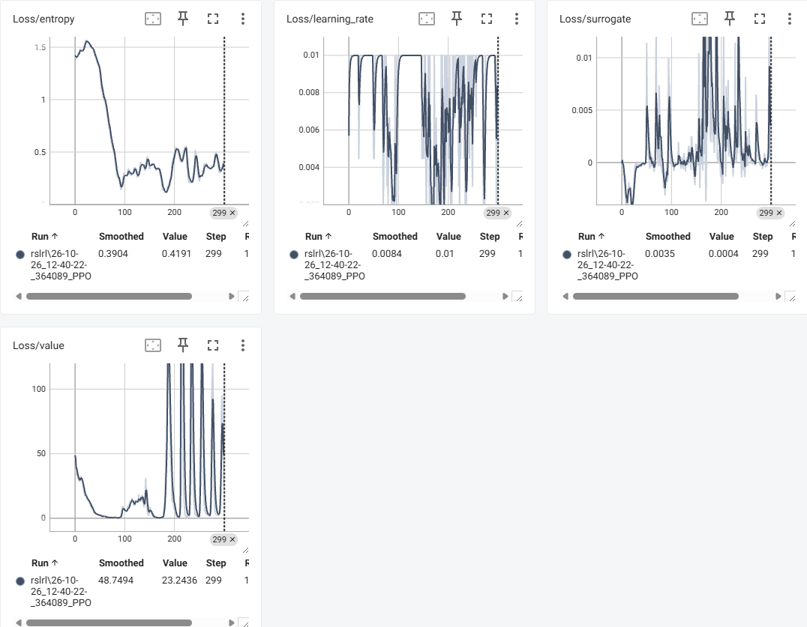

# 作业提交答题卡\_第二周

# 一、第 5 讲 配置系统：环境配置与训练配置怎么协作（25 分）


### 选择题（10 分，每题 1 分）


|题号|1|2|3|4|5|6|7|8|9|10|
|---|---|---|---|---|---|---|---|---|---|---|
|答案|B|C|D|B|B|C|B|A|A|B|


---


### 第 5 讲 应用题（归类 \+ 改错）（15 分）


#### \(a\) 字段归类（8 分）


|配置类|字段|
|---|---|
|**EnvCfg**|model\_file，sim\_dt，render\_spacing，max\_episode\_seconds|
|**RLCfg**|learning\_rate，num\_envs，rollouts，ratio\_clip|


#### \(b\) 找错（7 分）


**会发生什么：**

程序在创建环境配置时抛出 `ValueError`，环境不会被成功创建。


**原因：**

`registry.make()` 会遍历 `env_cfg_override`，并用 `hasattr(env_cfg, key)` 检查配置对象是否存在对应字段。`not_exist_param` 没有在 `MyEnvCfg` 中定义，因此 `hasattr(env_cfg, "not_exist_param")` 返回 `False`，触发 `ValueError`。


**正确写法示例：**


```Python
env = registry.make(
    name="my-env",
    sim_backend="np",
    num_envs=256,
    env_cfg_override={"reset_noise_scale": 2.0},
)
```


---


## 二、第 6 讲 注册系统：新环境如何接入框架（35 分）

### 选择题（10 分，每题 1 分）

|题号|1|2|3|4|5|6|7|8|9|10|
|---|---|---|---|---|---|---|---|---|---|---|
|答案|A|B|B|C|B|A|A|B|C|A|

---


### 第 6 讲 应用题（simple\_walker 代码填空）（25 分）


#### \(a\) 配置类（8 分）`motrix_envs/.../simple_walker/cfg.py`


```Python
@registry.envcfg("simple_walker")
@dataclass
class SimpleWalkerEnvCfg(EnvCfg):
    # 机器人和场景模型文件，NpEnv 创建仿真模型时使用
    model_file: str = model_file

    # reset 时根节点的初始离地高度，用于设置初始站立姿态
    init_root_height: float = 1.0

    # 判定机器人保持站立以及计算站立奖励时使用的目标高度
    stand_height: float = 0.8

    # 期望的水平行走速度，用于计算速度跟踪奖励
    target_speed: float = 1.0

    # reset 时施加到关节位置和速度上的随机噪声，提高策略鲁棒性
    reset_noise_scale: float = 0.05

    # 一个 episode 的最长仿真时间
    max_episode_seconds: float = 20.0

    # 物理仿真步长与策略控制步长
    sim_dt: float = 0.005
    ctrl_dt: float = 0.02
    
```


#### \(b\) 环境实现（8 分）`simple_walker_np.py`


```Python
import motrixsim as mtx
import numpy as np

from motrix_envs import registry
from motrix_envs.np.env import NpEnv, NpEnvState

from .cfg import SimpleWalkerEnvCfg


@registry.env("simple_walker", "np")
class SimpleWalkerEnv(NpEnv):
    def apply_action(
        self, actions: np.ndarray, state: NpEnvState
    ) -> NpEnvState:
        ...

    def update_state(self, state: NpEnvState) -> NpEnvState:
        ...

    def reset(
        self, data: mtx.SceneData
    ) -> tuple[np.ndarray, dict]:
        ...
```


**必须实现的三个抽象方法：**

1、apply\_action\(\)

2、update\_state\(\)

3、reset\(\)


#### \(c\) import 链（6 分）


1. `motrix_envs/.../simple_walker/__init__.py`：

    

```Python
from . import simple_walker_np  # noqa: F401
```


2. 对应分类（如 `motrix_envs/envs/basic/__init__.py`）：

    

```Python
from . import anymal_c, go1, go2, simple_walker  # noqa: F401
```


3. RL 侧 `motrix_rl/cfgs.py`：

    

```Python
@rlcfg("simple_walker")
@dataclass
class SimpleWalkerSkrlPpo(SkrlCfg):
    def __post_init__(self):
        self.num_envs = 2048
        self.play_num_envs = 16

        self.runner.seed = 42
        self.runner.agent.rollouts = 24
        self.runner.agent.learning_rate = 2.0e-4
        self.runner.trainer.timesteps = 20000
```


#### \(d\) 验证命令（3 分）


```Python
uv run scripts/train.py --env simple_walker --sim-backend np --train-backend torch --rllib skrl --num-envs 64
```


---


## 三、第 7 讲 训练流程：从 train\.py 到模型保存（40 分）


### 选择题（10 分，每题 1 分）


|题号|1|2|3|4|5|6|7|8|9|10|
|---|---|---|---|---|---|---|---|---|---|---|
|答案|B|C|B|A|C|B|C|A|B|C|

---


### 第 7 讲 实操题（必做，红线项）（30 分）


#### 证据 1：输出目录截图（8 分）


- 我的路径：`runs/cartpole/rslrl/26-10-26_12-40-22-_364089_PPO/`

- 截图：


​    

#### 证据 2：TensorBoard 分析（10 分）


- 命令：`uv run tensorboard --logdir runs/cartpole`

- 截图：



- 一句话趋势结论：

    Train/mean\_reward 从约 30\.53 明显上升，中期最高达到 1000，最终约为 314\.52；策略已经学会延长平衡时间，但后期出现回落，训练稳定性仍有提升空间，value loss 最终约为 23\.24。

    

#### 证据 3：推理演示（12 分）


- 命令：

    

```Python
uv run scripts/play.py --env cartpole --rllib rslrl --num-envs 1 --policy runs/cartpole/rslrl/26-10-26_12-40-22-_364089_PPO/model_299.pt
```


- 实际使用的 checkpoint 路径：runs/cartpole/rslrl/26\-10\-26\_12\-40\-22\-\_364089\_PPO/model\_299\.pt

- 一句话结果：

model\_299\.pt 已成功加载，Actor/Critic 网络完成构建并进入 `Starting evaluation loop`，说明环境、策略结构和 checkpoint 能够正确闭环推理。

