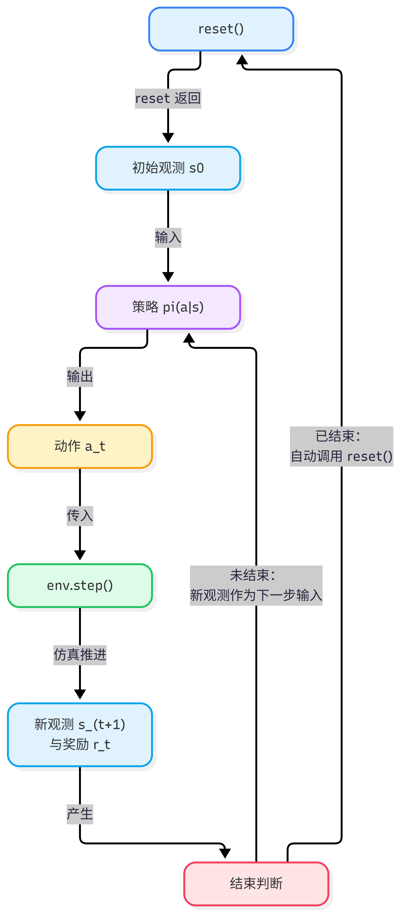
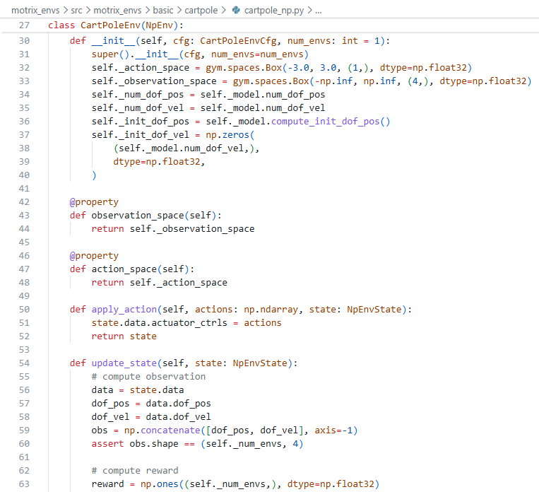
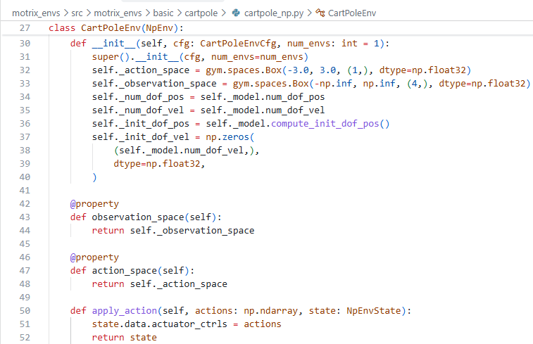
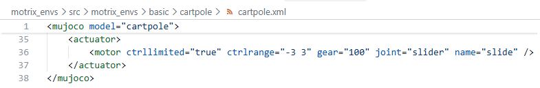
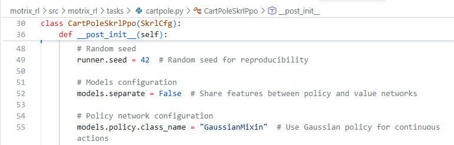
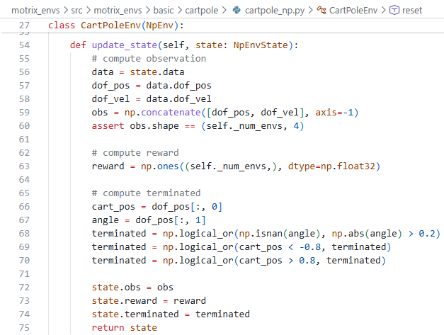
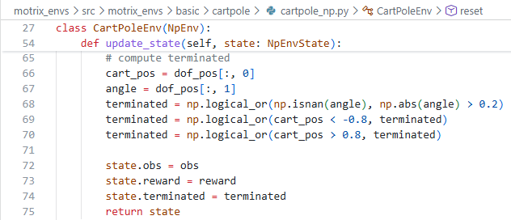
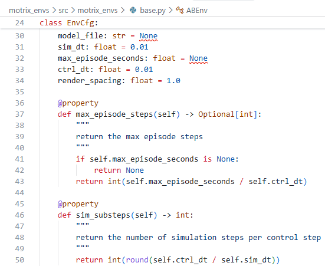
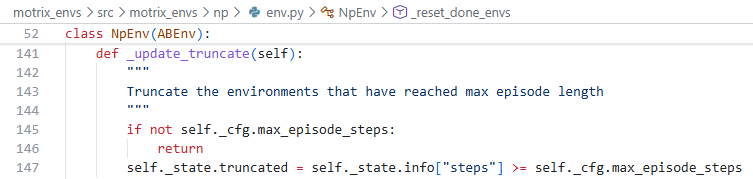
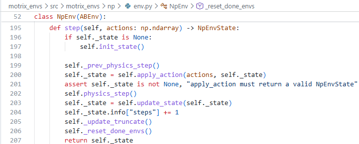

# 作业提交答题卡\_第三周

# 

## 一、任务与交互流程（20 分）


### 1\. 一句话问答（4 分）


- **策略输出的动作直接作用于哪个部件？**（2 分）

    - 答：策略输出的一维连续动作直接写入名为 `slide` 的电机执行器，该执行器驱动小车的 `slider` 滑动关节，使小车沿 x 轴运动。

        

- **CartPole 任务希望小车和摆杆保持什么状态？**（2 分）

    - 答：倒立摆：希望小车留在轨道中央附近，同时使摆杆保持接近竖直，并尽可能长时间不触发小车位置或摆杆角度越界。

        

### 2\. 一个回合的交互流程图（12 分）


> 要求包含：reset、观测、策略、动作、step、奖励、结束判断；用箭头标出四条关系（每条 3 分）。
> 
> 





四条关系标注核对：

1. 初始观测从哪里来：`NpEnv.init_state()` 创建状态后调用 `_reset_done_envs()`，后者调用 `CartPoleEnv.reset()`；`reset()` 设置带随机噪声的位置和速度，并返回初始观测。

2. 动作传给了谁：策略动作传给 `env.step()`，再由 `CartPoleEnv.apply_action()` 写入 `state.data.actuator_ctrls`，最终交给 XML 中驱动 `slider` 关节的 `slide` 电机。

3. 新观测怎样用于下一步：物理仿真推进后，`CartPoleEnv.update_state()` 生成新观测；若回合未结束，该观测作为策略下一次决策的输入。

4. 回合结束后怎样重新开始：`terminated` 或 `truncated` 为真时，`NpEnv.step()` 末尾调用 `_reset_done_envs()`，对已经结束的环境再次调用 `CartPoleEnv.reset()`。

    

### 3\. terminated 与 truncated（4 分）


|标志|含义（1 分）|CartPole 触发情形举例（1 分）|
|---|---|---|
|terminated|失败终止|摆杆角度绝对值严格大于 `0.2 rad`；或小车位置严格小于 `-0.8 m`、严格大于 `0.8 m`；或摆杆角度为 `NaN`。|
|truncated|超时截断|状态始终正常，但执行步数达到 `1000` 步，即 `10 s / 0.01 s = 1000` 步。|


---


## 二、八要素表（40 分）


> 每行 5 分：两个问题各 2 分，来源 1 分。代码未实现的写“未实现”并注明查找位置。
> 
> 


|要素|答案|来源|
|---|---|---|
|**智能体**|① 策略控制的对象：小车 `cart` 的 `slider` 滑动关节及其 `slide` 电机 ② 接收什么信息、输出什么动作：策略接收四维观测 `[x, theta, x_dot, theta_dot]`，输出一维连续电机控制量。|`cartpole_np.py init()`、`apply_action()`；`cartpole.xml <actuator>`|
|**环境**|① 仿真场景主要对象：地面 `floor`、轨道 `rail`、小车 `cart`、摆杆 `pole`、小车的 `slider` 关节、摆杆的 `hinge` 关节以及 `slide` 电机。② 场景文件加载位置：`cfg.py` 将 `model_file` 指向 `cartpole.xml`，`NpEnv.init()` 通过 `mtx.load_model(cfg.model_file)` 加载。|`cartpole.xml <worldbody>`、`<actuator>`；`cartpole/cfg.py CartPoleEnvCfg`；`np/env.py NpEnv.init()`|
|**观测**|① 观测向量维度：四维。 ② 各分量顺序与物理含义：`[小车位置 x, 摆杆角度 theta, 小车线速度 x_dot, 摆杆角速度 theta_dot]`，分别对应 `dof_pos` 的两个分量后接 `dof_vel` 的两个分量。|`cartpole_np.py init()`、`update_state()`；关节顺序见 `cartpole.xml`|
|**动作**|① 动作维数与取值范围： `[-3.0, 3.0]`。 ② 作用于哪个部件、表示什么物理量：动作写入 `slide` 电机的控制量；电机驱动小车的 `slider` 关节。XML 设置 `gear="100"`，因此限制后的控制量经 gear 转为小车滑动方向的广义力。|`cartpole_np.py init()`、`apply_action()`；`cartpole.xml <motor>`|
|**奖励**|① 每步奖励计算方式：每个并行环境在每一步都得到 `1.0`，代码没有额外奖励项或惩罚项。② 鼓励什么行为：鼓励小车不越界并让摆杆尽可能长时间保持平衡，因为回合存活越久累计奖励越大。|`cartpole_np.py update_state()`|
|**初始状态**|① 位置和角度初值/范围：XML 默认关节初值为 0；reset 时，小车位置和摆杆角度分别在各自的 0 初值上加入 `U(-0.01, 0.01)` 噪声，即小车约为 `[-0.01, 0.01] m`，摆杆约为 `[-0.01, 0.01] rad`。 ② 速度初值/范围：基准速度均为 0；小车线速度和摆杆角速度也分别加入 `U(-0.01, 0.01)` 噪声，即约为 `[-0.01, 0.01] m/s` 与 `[-0.01, 0.01] rad/s`。|`cartpole_np.py init()`、`reset()`；`cartpole/cfg.py CartPoleEnvCfg`|
|**终止条件**|① 哪些失败/异常结束回合：`angle` 为 `NaN`、`abs(angle) > 0.2 rad`、`cart_pos < -0.8 m` 或 `cart_pos > 0.8 m` 时失败终止。② 多少秒/步数截断（写出换算）：最长 `10 s`；继承的 `ctrl_dt = 0.01 s`，所以 `max_episode_steps = int(10 / 0.01) = 1000` 步，在 `steps >= 1000` 时截断。|`cartpole_np.py update_state()`；`cartpole/cfg.py CartPoleEnvCfg`；`base.py EnvCfg.max_episode_steps`；`np/env.py _update_truncate()`|
|**域随机化**|① 哪些参数/状态被随机设置、范围：实现初始状态随机化：两个位置自由度和两个速度自由度都叠加 `U(-0.01, 0.01)` 噪声。② 何时重新采样：每次 `CartPoleEnv.reset()` 时重新采样，包括初次初始化及任一环境 `terminated/truncated` 后的自动重置。|`cartpole_np.py reset()`；`np/env.py init_state()`、`_reset_done_envs()`|


---


## 三、代码阅读（40 分）


### 1\. 观测（10 分）


- **（3 分）截图展示生成观测向量的代码**（需能看到文件名）：



- **（2 分）按实际顺序列出各分量**：

1\.`dof_pos[:, 0]`：小车 `slider` 关节位置 `x`。

2\.`dof_pos[:, 1]`：摆杆 `hinge` 关节角度 `theta`。

3\.`dof_vel[:, 0]`：小车沿 x 轴的线速度 `x_dot`。

4\.`dof_vel[:, 1]`：摆杆绕 y 轴的角速度 `theta_dot`。


- **（3 分）各分量物理含义与单位**：

    

|分量|物理含义|单位|
|---|---|---|
|1 `x`|小车相对轨道原点的平移位置|m|
|2 `theta`|摆杆相对初始竖直姿态、绕 y 轴的转角|rad|
|3 `x_dot`|小车沿 x 轴的平移速度|m/s|
|4 `theta_dot`|摆杆绕 y 轴的角速度|rad/s|


- **（2 分）维度核对**：

    - 各分量维度相加：\_1\_ \+ \_1\_ \+ \_1\_ \+ \_1\_ = \_4\_

    - 与 `observation_space` 定义对照：与 `self._observation_space = gym.spaces.Box(-np.inf, np.inf, (4,), dtype=np.float32)` 一致。

        

### 2\. 动作（10 分）


- **（3 分）截图展示把动作传入仿真的代码**：








- **（3 分）动作控制的部件与物理量**：

答：动作控制 XML 中名为 `slide` 的 motor actuator，该执行器连接小车的 `slider` 滑动关节。一维动作首先是电机控制输入；`ctrllimited="true"` 使实际控制输入限制在 `[-3, 3]`，再通过 `gear="100"` 作用为 slider 方向的广义力。按该模型的平移关节理解，最大力幅值为 `3 × 100 = 300 N`。


- **（4 分）动作从策略输出到执行器的完整路径**（每环注明是否裁剪/缩放及规则）：

    

```Plain Text
策略输出 → SkrlNpWrapper / 策略框架层（无裁剪、无缩放，仅 Tensor 转 NumPy） → CartPoleEnv.apply_action() / 环境接口层（无裁剪、无缩放，直接赋值给 actuator_ctrls） → 执行器 → 物理量
```


三处检查：

- `apply_action()`：无裁剪、无缩放，直接赋给 `actuator_ctrls`（有无裁剪/缩放，规则）

- `cartpole.xml` 中 `ctrlrange` 与 `gear`：`ctrlrange="-3 3"`、`ctrllimited="true"`，执行器限制输入；`gear="100"`，把控制输入按 100 倍转换为 slider 关节广义力。

- 训练配置中的 `clip_actions`：`models.policy.clip_actions = False`，策略模型不执行动作裁剪。

    

### 3\. 奖励（10 分）


- **（2 分）截图展示单步奖励代码**：




- **（4 分）累计奖励计算**（每步奖励 1、不考虑折扣）：

    - 持续 20 步：`R = 20 × 1 = 20`。

    - 持续 80 步：`R = 80 × 1 = 80`。

        

- **（4 分）结合回合结束条件，解释为何能鼓励保持平衡**：

答：只有在回合继续时，智能体才能继续获得后续每步的 `+1`。如果摆杆角度越过 `±0.2 rad`、小车位置越过 `±0.8 m`，或出现 `NaN`，回合会立即终止，之后本回合不再累积奖励。因此，最大化累计回报等价于延长回合存活时间，策略会学习通过左右移动小车来抑制摆杆倾倒并避免小车越界。若始终不失败，最多可持续 1000 步并获得约 1000 的未折扣累计奖励。


### 4\. 终止与截断（10 分）


- **（6 分）分类与判据数值**：

    

|情形|分类（失败终止/时间截断）|代码判据数值|
|---|---|---|
|① 杆角度越界|失败终止 `terminated`|`abs(angle) > 0.2 rad`。注意代码是严格大于，恰好等于 `0.2` 不触发。|
|② 小车位置越界|失败终止 `terminated`|`cart_pos < -0.8 m` 或 `cart_pos > 0.8 m`。恰好等于边界不触发。|
|③ 状态正常但超时|时间截断 `truncated`|`max_episode_seconds = 10 s`，`ctrl_dt = 0.01 s`，所以 `max_episode_steps = 10 / 0.01 = 1000`；当 `steps >= 1000` 时截断。|


- **（2 分）截图展示失败判定和超时截断代码**：










- **（2 分）回合结束后由谁、调用哪个函数重置**：

    - 答：`NpEnv.step()` 在完成 `update_state()`、步数加一和 `_update_truncate()` 后调用 `NpEnv._reset_done_envs()`。该函数通过 `NpEnvState.done = terminated OR truncated` 找到已经结束的并行环境，并对这些环境调用子类实现的 `CartPoleEnv.reset(data)`，从而重新采样初始状态并写入新的初始观测。

