# 作业提交答题卡\_第四周

# 作业提交答题卡

# 一、三个 Demo 的运行与比较（35 分）


## 1\. 训练并回放 CartPole、Pendulum、Acrobot（15 分）


### 1\.1 CartPole

训练命令：

```PowerShell
uv run scripts/train.py --env cartpole --rllib skrl --train-backend torch --num-envs 2048 --seed 42
```


回放命令：

```PowerShell
uv run scripts/play.py --env cartpole --rllib skrl --num-envs 1 --seed 0 --policy runs/cartpole/skrl/26-11-06_23-25-21-545932_PPO/checkpoints/best_agent.pt
```

- 实际训练步数：5000 个 batch environment steps，即约 `5000 × 2048 = 10,240,000` 条并行环境 transition。

- 模型文件：`runs/cartpole/skrl/26-11-06_23-25-21-545932_PPO/checkpoints/best_agent.pt`

- 训练结束日志：

```Python
Motphys profiler initialized: disabled
I1106 23:25:18.762329 42024 train.py:87] DeviceSupports(torch=True, torch_gpu=True, jax=False, jax_gpu=False)
[skrl:WARNING] Using `from skrl.envs.torch import ...` is deprecated and will be removed in future versions.
W1106 23:25:20.628691 42024 torch.py:5] Using `from skrl.envs.torch import ...` is deprecated and will be removed in future versions.
[skrl:WARNING]  - Import loaders using `from skrl.envs.loaders.torch import ...`
W1106 23:25:20.628691 42024 torch.py:6]  - Import loaders using `from skrl.envs.loaders.torch import ...`
[skrl:WARNING]  - Import wrappers using `from skrl.envs.wrappers.torch import ...`
W1106 23:25:20.628691 42024 torch.py:7]  - Import wrappers using `from skrl.envs.wrappers.torch import ...`
[skrl:INFO] Seed: 42
I1106 23:25:21.067377 42024 __init__.py:82] Seed: 42
100%|��������������������| 5000/5000 [01:03<00:00, 78.28it/s] 
[skrl:INFO] Closing environment
I1106 23:26:38.249297 42024 base.py:80] Closing environment
[skrl:INFO] Environment closed
I1106 23:26:38.249297 42024 base.py:82] Environment closed

```

- TensorBoard 奖励曲线：

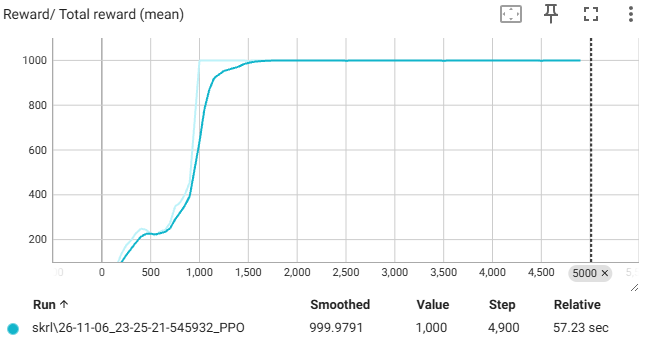

趋势结论：平均回合奖励从约 32\.4 快速升至并稳定在 1000；1000 正好是 10 s / 0\.01 s 的时间上限，说明策略已能把大多数回合维持到截断。


- 完整回合视频：\[CartPole seed=0 完整回合\]\(videos/cartpole\_完整回合\_seed0\.mp4\)（1000 步，`terminated=False, truncated=True`）。


### 1\.2 Pendulum

本小题使用第二题 A 组，即默认奖励。


训练命令：

```PowerShell
uv run scripts/train.py --env pendulum --rllib skrl --train-backend torch --num-envs 2048 --seed 42
```


回放命令：

```PowerShell
uv run scripts/play.py --env pendulum --rllib skrl --num-envs 1 --seed 0 --policy runs/pendulum/skrl/26-11-06_23-27-53-463527_PPO/checkpoints/best_agent.pt
```


- 实际训练步数：5000 个 batch environment steps，即约 10,240,000 条 transition。

- 模型文件：`runs/pendulum/skrl/26-11-06_23-27-53-463527_PPO/checkpoints/best_agent.pt`

- 训练结束日志：

```Python
Motphys profiler initialized: disabled
I1106 23:27:53.089621 49920 train.py:87] DeviceSupports(torch=True, torch_gpu=True, jax=False, jax_gpu=False)
[skrl:WARNING] Using `from skrl.envs.torch import ...` is deprecated and will be removed in future versions.
W1106 23:27:53.276242 49920 torch.py:5] Using `from skrl.envs.torch import ...` is deprecated and will be removed in future versions.
[skrl:WARNING]  - Import loaders using `from skrl.envs.loaders.torch import ...`
W1106 23:27:53.276242 49920 torch.py:6]  - Import loaders using `from skrl.envs.loaders.torch import ...`
[skrl:WARNING]  - Import wrappers using `from skrl.envs.wrappers.torch import ...`
W1106 23:27:53.276242 49920 torch.py:7]  - Import wrappers using `from skrl.envs.wrappers.torch import ...`
[skrl:INFO] Seed: 42
I1106 23:27:53.432178 49920 __init__.py:82] Seed: 42
...
100%|��������������������| 5000/5000 [01:01<00:00, 81.86it/s]
[skrl:INFO] Closing environment
I1106 23:28:55.828997 49920 base.py:80] Closing environment
[skrl:INFO] Environment closed
I1106 23:28:55.828997 49920 base.py:82] Environment closed
```

- TensorBoard 奖励曲线（黑线为默认奖励 A 组）：

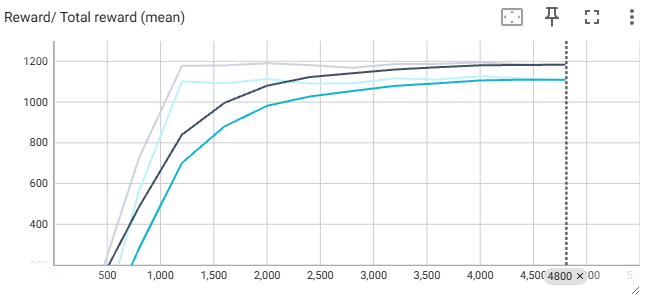


### 1\.3 Acrobot

训练命令：

```PowerShell
uv run scripts/train.py --env acrobot --rllib skrl --train-backend torch --num-envs 2048 --seed 42
```


回放命令：

```PowerShell
uv run scripts/play.py --env acrobot --rllib skrl --num-envs 1 --seed 0 --policy runs/acrobot/skrl/26-11-06_23-31-39-962958_PPO/checkpoints/best_agent.pt
```


- 实际训练步数：29000 个 batch environment steps，即约 `29,000 × 2048 = 59,392,000` 条 transition。

- 模型文件：`runs/acrobot/skrl/26-11-06_23-31-39-962958_PPO/checkpoints/best_agent.pt`

- 训练结束日志：

```Python
Motphys profiler initialized: disabled
I1106 23:31:39.716334 54936 train.py:87] DeviceSupports(torch=True, torch_gpu=True, jax=False, jax_gpu=False)
[skrl:WARNING] Using `from skrl.envs.torch import ...` is deprecated and will be removed in future versions.
W1106 23:31:39.869324 54936 torch.py:5] Using `from skrl.envs.torch import ...` is deprecated and will be removed in future versions.
[skrl:WARNING]  - Import loaders using `from skrl.envs.loaders.torch import ...`
W1106 23:31:39.869324 54936 torch.py:6]  - Import loaders using `from skrl.envs.loaders.torch import ...`
[skrl:WARNING]  - Import wrappers using `from skrl.envs.wrappers.torch import ...`
W1106 23:31:39.869324 54936 torch.py:7]  - Import wrappers using `from skrl.envs.wrappers.torch import ...`
[skrl:INFO] Seed: 42
I1106 23:31:39.929667 54936 __init__.py:82] Seed: 42
...
100%|��������������������| 29000/29000 [05:36<00:00, 86.22it/s]
[skrl:INFO] Closing environment
I1106 23:37:17.439986 54936 base.py:80] Closing environment
[skrl:INFO] Environment closed
I1106 23:37:17.439986 54936 base.py:82] Environment closed
```

- TensorBoard 奖励曲线：

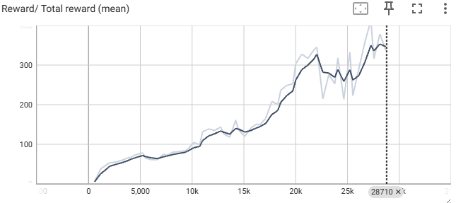


---


## 2\. 八要素对比表（16 分）

Pendulum 观测/动作/奖励截图：

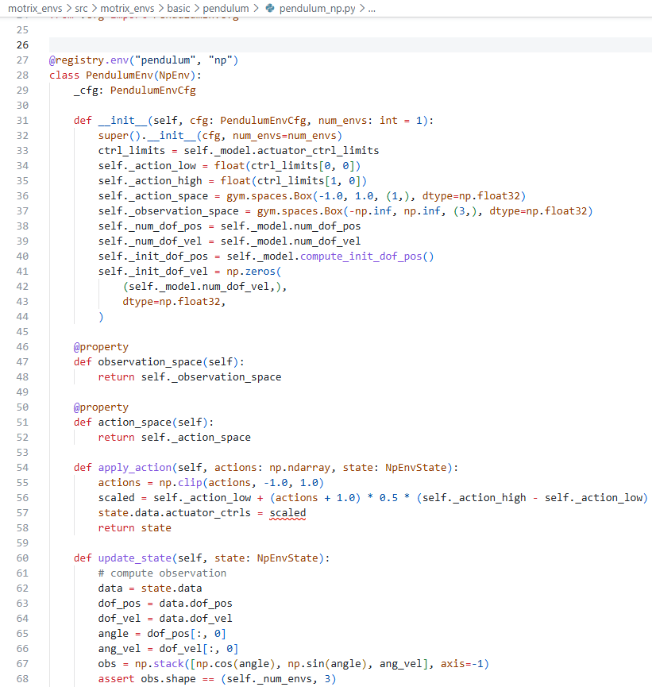

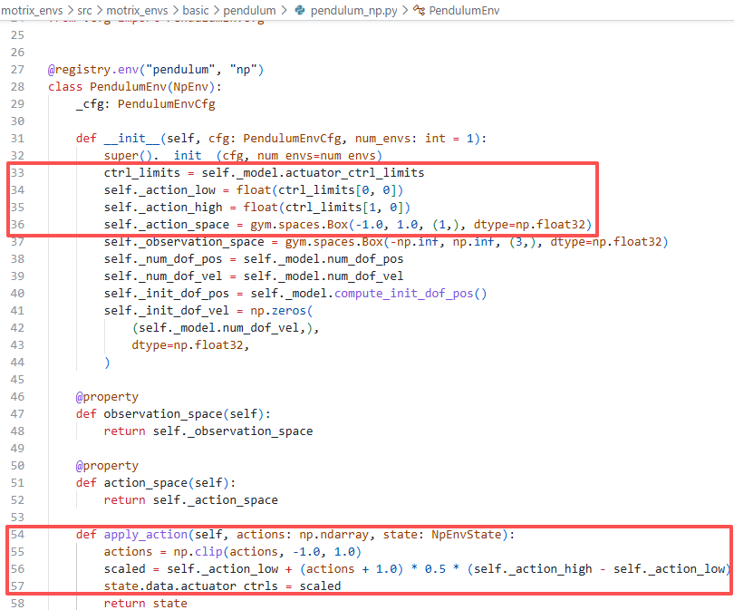


Acrobot 观测/动作/奖励截图：

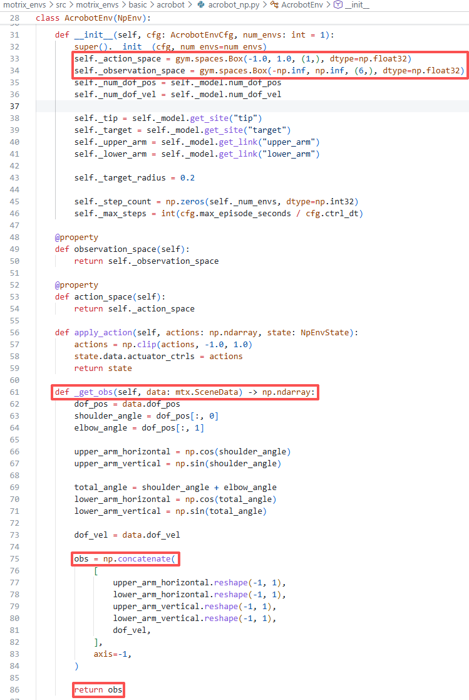

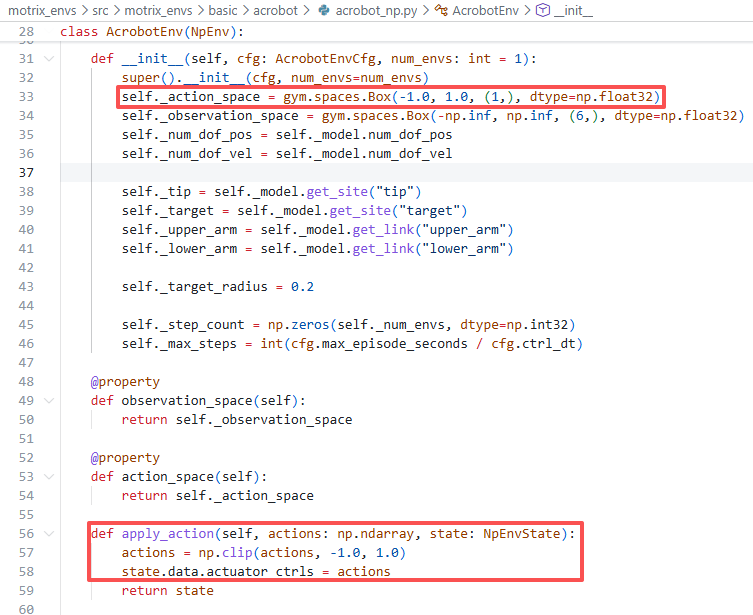

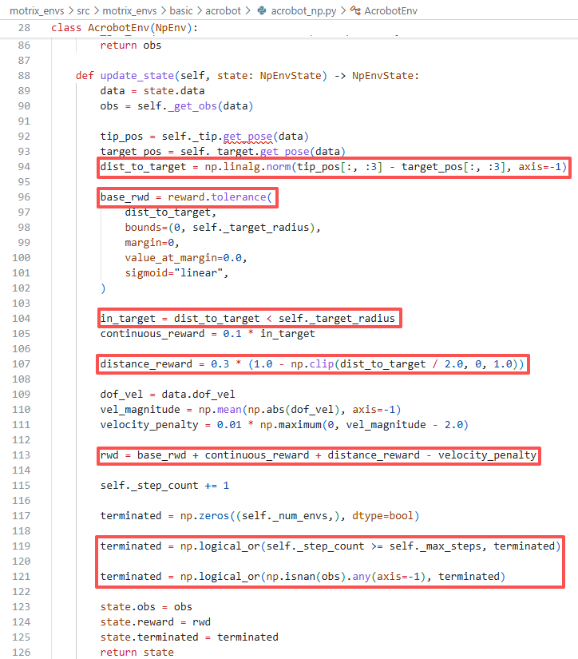

超时通用逻辑截图：

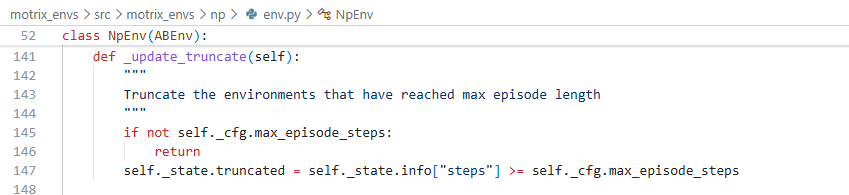

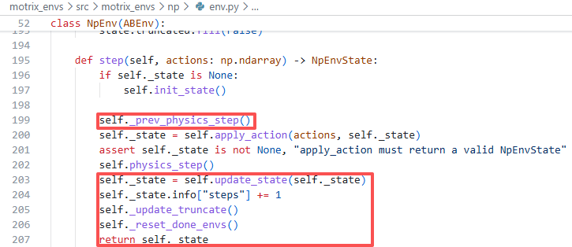


---


## 3\. 观测编码与欠驱动（4 分）


### 3\.1 角度跨越 ±π 时直接输入 vs sin/cos 编码（2 分）

取跨界前 `θ₁=π−0.01≈3.13159`，跨界后同一邻近姿态表示为 `θ₂=−π+0.01≈−3.13159`：


- 直接角度编码从 `3.13159` 跳到 `−3.13159`，数值突变约 `−6.26318 rad`，虽然物理姿态只变化了 `0.02 rad`。

- sin/cos 编码：跨界前约 `[-0.99995, +0.0099998]`，跨界后约 `[-0.99995, −0.0099998]`，向量只连续变化约 0\.02，没有 2π 跳变。

    

因此 sin/cos 编码更适合周期角度，网络不用额外学习 `π` 与 `−π` 是相邻姿态。来源：`pendulum_np.py PendulumEnv.update_state()`；`acrobot_np.py AcrobotEnv._get_obs()`。

### 3\.2 Acrobot 关节与驱动（2 分）

Acrobot 有 2 个转动关节：`shoulder` 和 `elbow`；动作只有 1 维。XML 的 `<actuator>` 只有一个 motor，`joint="elbow"`，所以 elbow 直接受驱动，shoulder 没有执行器，只能依靠耦合动力学被间接带动，故为欠驱动系统。

---


# 二、单摆能量奖励对照实验（40 分）


## 1\. 能量项的代码（8 分）

A 组默认代码中：


```Python
energy = 0.5 * ang_vel**2 + (1.0 - np.cos(angle_wrapped))
energy_target = 2.0
energy_reward = reward_utils.tolerance(...)
reward = 3.0 * upright + energy_reward - vel_penalty - ...
```


能量计算及加入总奖励的截图：

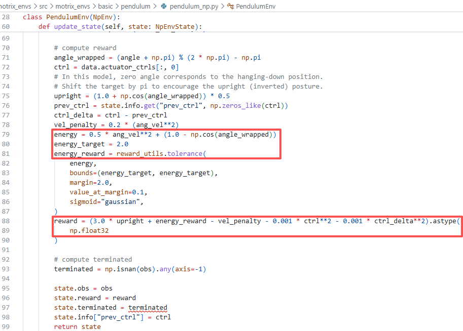

B 组只改总奖励中能量项的贡献，保留能量项计算和其他所有项：


```Python
reward = 3.0 * upright + 0.0 * energy_reward - vel_penalty - 0.001 * ctrl**2 - 0.001 * ctrl_delta**2
```


修改行截图:


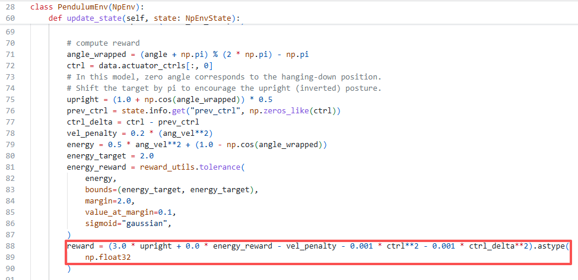

## 2\. 对照参数表（8 分）

|参数|A 组|B 组|来源|
|---|---|---|---|
|MotrixLab 版本、训练后端|v0\.3\.0；SKRL PPO；Torch|v0\.3\.0；SKRL PPO；Torch|根目录及子包 `pyproject.toml`；训练命令；`scripts/train.py`。|
|训练种子、并行环境数|seed=42；2048 envs|seed=42；2048 envs|命令行；`motrix_rl/skrl/config.py SkrlCfg/SkrlRunnerCfg`。|
|训练步数、学习率|5000 batch env steps（约 10\.24M transitions）；`3e-4`|完全相同|`motrix_rl/tasks/pendulum.py PendulumSkrlPpo.__post_init__()`。|
|网络结构、其他奖励项、回合时长|policy/value 均 `[64,64]`，ELU；`3·upright − 0.2θ̇² − 0.001u² − 0.001Δu²`；10 s = 400 控制步|完全相同；唯一差异是 `energy_reward` 对总奖励的系数由 1 改为 0|`pendulum.py PendulumSkrlPpo.__post_init__()`；`pendulum_np.py update_state()`；`pendulum/cfg.py PendulumEnvCfg`。|

## 3\. 训练证据（6 分）


### A 组

训练命令：


```PowerShell
uv run scripts/train.py --env pendulum --rllib skrl --train-backend torch --num-envs 2048 --seed 42
```


模型：`runs/pendulum/skrl/26-11-06_23-27-53-463527_PPO/checkpoints/best_agent.pt`

```Python
Motphys profiler initialized: disabled
I1106 23:27:53.089621 49920 train.py:87] DeviceSupports(torch=True, torch_gpu=True, jax=False, jax_gpu=False)
[skrl:WARNING] Using `from skrl.envs.torch import ...` is deprecated and will be removed in future versions.
W1106 23:27:53.276242 49920 torch.py:5] Using `from skrl.envs.torch import ...` is deprecated and will be removed in future versions.
[skrl:WARNING]  - Import loaders using `from skrl.envs.loaders.torch import ...`
W1106 23:27:53.276242 49920 torch.py:6]  - Import loaders using `from skrl.envs.loaders.torch import ...`
[skrl:WARNING]  - Import wrappers using `from skrl.envs.wrappers.torch import ...`
W1106 23:27:53.276242 49920 torch.py:7]  - Import wrappers using `from skrl.envs.wrappers.torch import ...`
[skrl:INFO] Seed: 42
I1106 23:27:53.432178 49920 __init__.py:82] Seed: 42
...
100%|��������������������| 5000/5000 [01:01<00:00, 81.86it/s]
[skrl:INFO] Closing environment
I1106 23:28:55.828997 49920 base.py:80] Closing environment
[skrl:INFO] Environment closed
I1106 23:28:55.828997 49920 base.py:82] Environment closed
```

### B 组

在 L88 把 `energy_reward` 乘 0 后，从头运行相同命令：


```PowerShell
uv run scripts/train.py --env pendulum --rllib skrl --train-backend torch --num-envs 2048 --seed 42
```


模型：`runs/pendulum/skrl/26-11-06_23-30-17-158047_PPO/checkpoints/best_agent.pt`

```Python
Motphys profiler initialized: disabled
I1106 23:30:16.912210 56844 train.py:87] DeviceSupports(torch=True, torch_gpu=True, jax=False, jax_gpu=False)
[skrl:WARNING] Using `from skrl.envs.torch import ...` is deprecated and will be removed in future versions.
W1106 23:30:17.091210 56844 torch.py:5] Using `from skrl.envs.torch import ...` is deprecated and will be removed in future versions.
[skrl:WARNING]  - Import loaders using `from skrl.envs.loaders.torch import ...`
W1106 23:30:17.091210 56844 torch.py:6]  - Import loaders using `from skrl.envs.loaders.torch import ...`
[skrl:WARNING]  - Import wrappers using `from skrl.envs.wrappers.torch import ...`
W1106 23:30:17.091210 56844 torch.py:7]  - Import wrappers using `from skrl.envs.wrappers.torch import ...`
[skrl:INFO] Seed: 42
I1106 23:30:17.107225 56844 __init__.py:82] Seed: 42
...
100%|��������������������| 5000/5000 [01:00<00:00, 82.59it/s] 
[skrl:INFO] Closing environment
I1106 23:31:18.943647 56844 base.py:80] Closing environment
[skrl:INFO] Environment closed
I1106 23:31:18.943647 56844 base.py:82] Environment closed
```

## 4\. 回放记录（10 分）

回放使用单环境和相同视角；每组分别取 seed 0、1、2。判据为相对竖直向上偏角不超过 15°。

|组别 / 回合|初始姿态|是否曾到达直立范围|末帧是否在直立范围内|证据时间点|
|---|---|---|---|---|
|A / 0|\+17\.57°|是|是（末帧 1\.51°）|首次约 0\.175 s|
|A / 1|−29\.87°|是|是（末帧 1\.51°）|首次约 0\.300 s|
|A / 2|−23\.04°|是|是（末帧 1\.51°）|首次约 0\.200 s|
|B / 0|\+17\.57°|是|是（末帧 3\.72°）|首次约 0\.150 s|
|B / 1|−29\.87°|是|是（末帧 3\.72°）|首次约 0\.725 s|
|B / 2|−23\.04°|是|是（末帧 3\.72°）|首次约 0\.475 s|

A 组三个完整回合：

[pendulum\_A\_完整回合\_seed0\.mp4](Appendix/pendulum_A_完整回合_seed0.mp4)

[pendulum\_A\_完整回合\_seed1\.mp4](Appendix/pendulum_A_完整回合_seed1.mp4)

[pendulum\_A\_完整回合\_seed2\.mp4](Appendix/pendulum_A_完整回合_seed2.mp4)

B 组三个完整回合：

[pendulum\_B\_完整回合\_seed2\.mp4](Appendix/pendulum_B_完整回合_seed2.mp4)

[pendulum\_B\_完整回合\_seed0\.mp4](Appendix/pendulum_B_完整回合_seed0.mp4)

[pendulum\_B\_完整回合\_seed1\.mp4](Appendix/pendulum_B_完整回合_seed1.mp4)


A / 0 末帧（标注偏角）：


B / 0 末帧（标注偏角）：


## 5\. 分析（8 分）


---


# 三、双关节机械臂 dm\-reacher 分析（25 分）

场景查看命令：


```PowerShell
uv run scripts/view.py --env dm-reacher --num-envs 1
```


场景结构标注图：

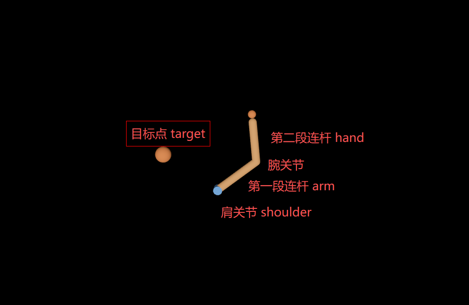

## 1\. 八要素表（选做，单独评价 16 分，不计入总分）

|要素|答案|来源|
|---|---|---|
|智能体|① 策略控制平面二连杆的 shoulder、wrist 两个 motor；② 接收实际 10 维观测，输出 2 维连续动作。|`reacher_np.py Reacher2DEnv._init_obs_space()/_init_action_space()`；`reacher.xml <actuator>`。|
|环境|① root、arm、hand、finger、可平移 target、shoulder/wrist/target\_x/target\_y 四个关节；② cfg 指向 `reacher.xml`，由 `NpEnv.__init__()` 的 `mtx.load_model()` 加载。|`reacher/cfg.py ReacherEnvCfg`；`reacher.xml`；`np/env.py NpEnv.__init__()`。|
|观测|实际为 10 维：`qpos(4) + to_target(2) + qvel(4)`。按 XML 关节顺序可解释为 `[shoulder角, wrist角, target_x, target_y, target_x−finger_x, target_y−finger_y, shoulder速度, wrist速度, target_x速度, target_y速度]`。官方常见 Reacher 描述若更短，是因为本实现把目标的两个 slide joint 也计入模型 qpos/qvel。|`reacher_np.py _init_obs_space()/_get_obs()`；`reacher.xml` 的四个 `<joint>`。|
|动作|2 维，范围均为 `[-1,1]`；动作 0 控制 shoulder，动作 1 控制 wrist；直接写入 actuator controls，XML 两电机 `gear=.05`。|`reacher_np.py _init_action_space()/apply_action()`；`reacher.xml <default>/<actuator>`。|
|奖励|末端到目标距离 `d`：`0≤d≤0.02 m` 奖励为 1；`0.02<d<0.04 m` 线性降至 0；`d≥0.04 m` 为 0。鼓励末端进入目标球。|`reacher_np.py update_state()`；`np/reward.py tolerance()/_sigmoids()`。|
|初始状态|shoulder、wrist 角各 `U[-π,π]`；target\_x `U[-0.15,0.15] m`，target\_y 实际恒 0\.15 m；`data.reset()` 后速度为默认 0。|`reacher_np.py reset()`。|
|终止条件|观测含 NaN 时 terminated；正常达到 6 s / 0\.025 s = 240 步时 truncated。|`reacher_np.py update_state()`；`reacher/cfg.py ReacherEnvCfg`；`np/env.py NpEnv._update_truncate()`。|
|域随机化|初始两关节角和目标位置每次 reset 重采样；代码声明 x 范围 `[-0.15,0.15]`、y 范围 `[0.15,0.15]`，所以实际变化范围为 x 可变 0\.30 m、y 变化 0 m。未实现质量/摩擦等模型参数随机化。|`reacher_np.py reset()`。|

## 2\. 关键代码（15 分）


### 2\.1 观测构造

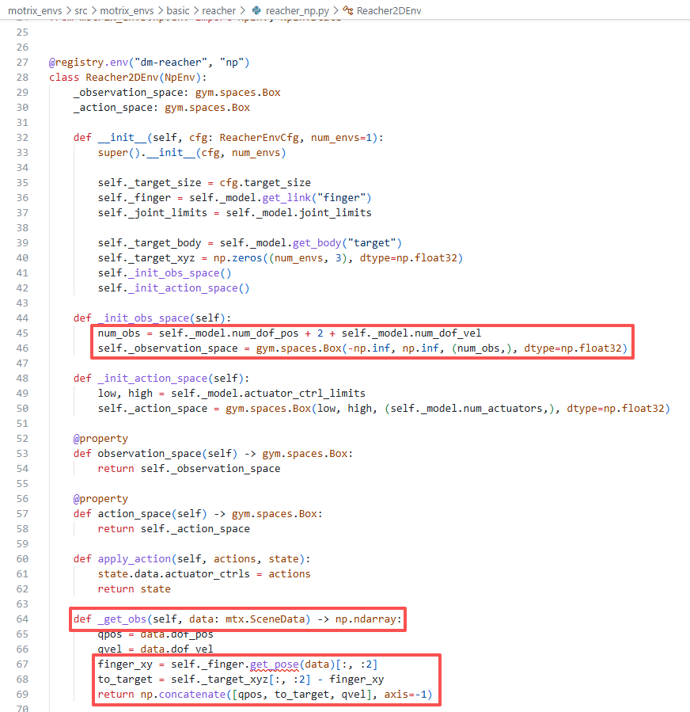

`qpos` 含 4 个关节位置，其中 target\_x/target\_y 已直接给出目标位置；此外 `to_target = target_xy − finger_xy` 又把末端到目标的相对向量加入观测；最后再拼接 4 个关节速度。因此目标信息同时以绝对目标关节位置和相对位置两种形式进入观测，实际总维度为 `4+2+4=10`。

### 2\.2 动作应用

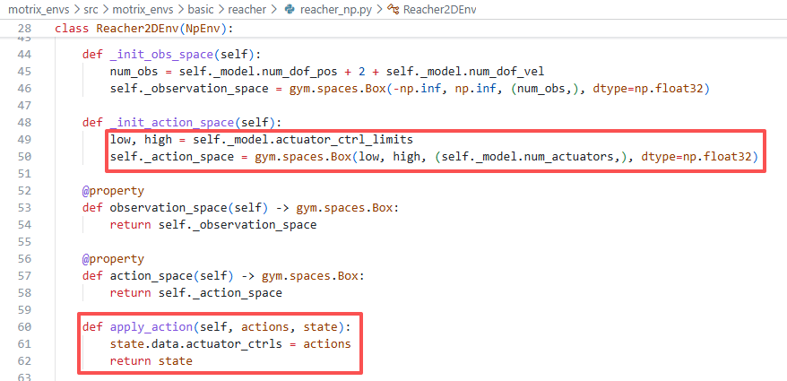

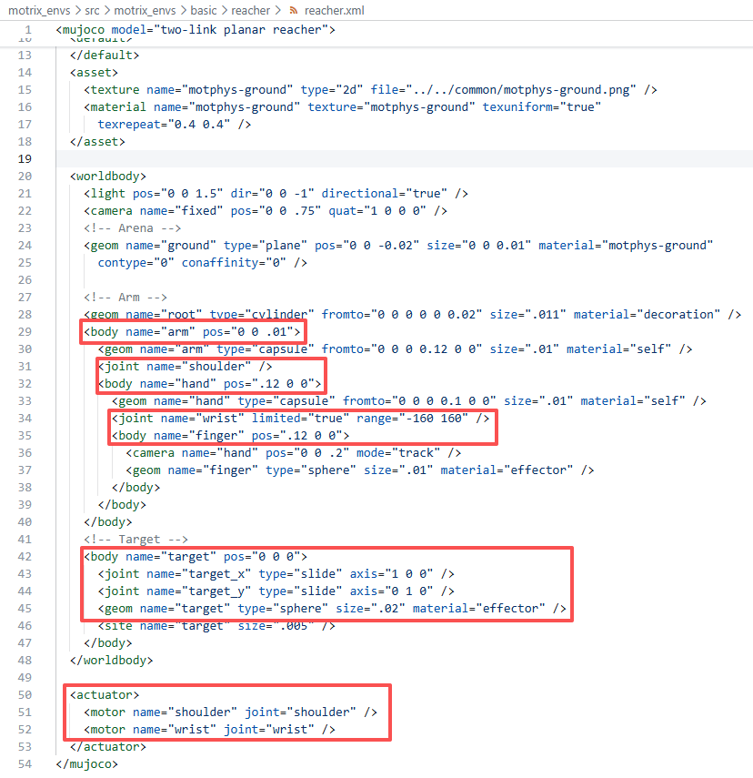

动作空间直接取模型 actuator ctrl limits，两个分量依 XML 顺序分别对应 `shoulder` 和 `wrist` motor。`apply_action()` 不额外裁剪或缩放，直接写 `state.data.actuator_ctrls`；XML 的 `ctrlrange="-1 1"` 限制控制输入，`gear=.05` 是执行器传动系数。

### 2\.3 奖励计算

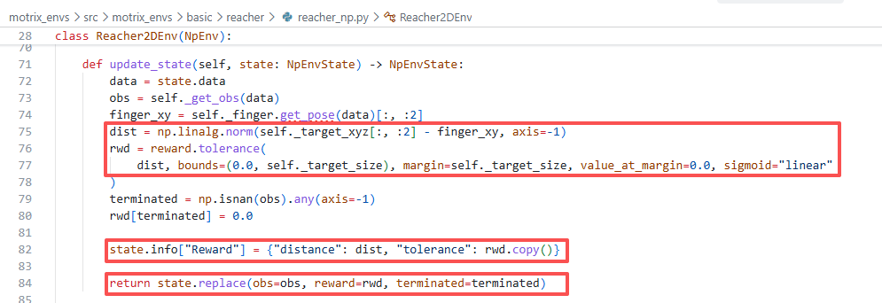

解释：代码先算 `d=||target_xy−finger_xy||`，再调用线性 `tolerance`。目标大小为 0\.02 m，所以 `d∈[0,0.02]` 时奖励精确为 1；在 `(0.02,0.04)` 线性下降；`d=0.04 m` 时降到 0，并在更远处保持 0。


目标随机化代码：

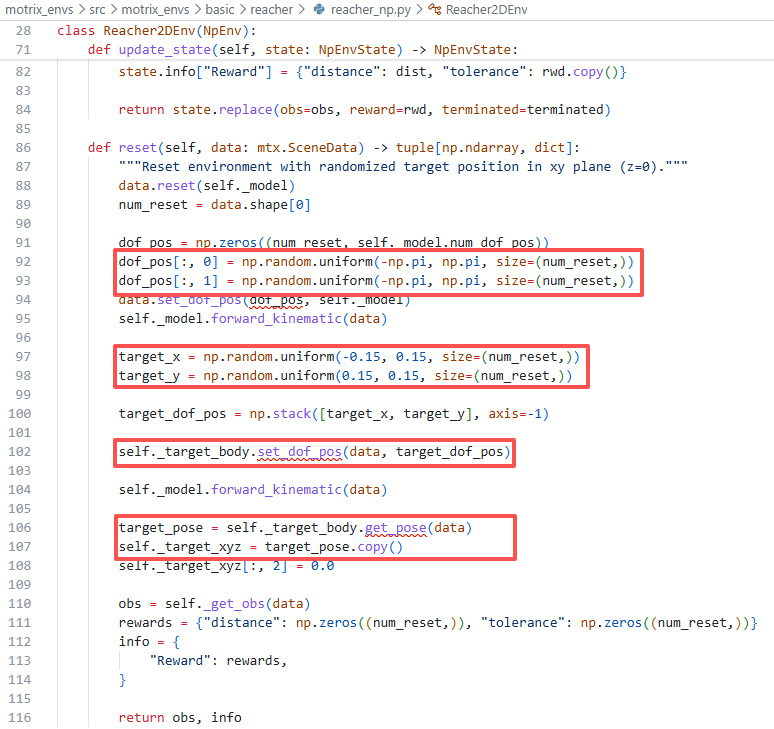

## 3\. 思考题（10 分）

**判断：不能可靠到达每回合变化的目标。**


原因：策略是从当前观测到动作的固定映射。若不同回合中机械臂姿态完全相同、但目标位置不同，而观测又完全不含目标信息，那么策略接收到的输入相同，只能输出相同动作；它无法知道应该朝左还是朝右，到达所有随机目标在信息论上不可辨识。它最多能学到目标分布下的平均/高概率位置，不能针对本回合目标闭环控制。


代码逐项检查：`_get_obs()` 输出 10 维：


1. 第 0、1 维：shoulder、wrist 角，是机械臂自身状态，可保留。

2. 第 2、3 维：target\_x、target\_y 的 qpos，是目标绝对位置，必须去掉。

3. 第 4、5 维：`to_target_x, to_target_y`，是目标相对末端位置，必须去掉。

4. 第 6、7 维：shoulder、wrist 速度，是机械臂自身状态，可保留。

5. 第 8、9 维：target\_x、target\_y 两个 slide joint 的速度；它们静止时通常为 0，不携带目标位置，但若要求观测完全不含任何 target joint 状态，也应一并去掉。

    

因此“去除所有目标位置信息”的最小修改是删除 qpos 中 target 的 2 维和 `to_target` 的 2 维；更严格的机器人自身状态观测还应同时删除目标关节速度，只保留 `[shoulder角, wrist角, shoulder速度, wrist速度]` 四维。来源：`reacher_np.py Reacher2DEnv._get_obs()`；`reacher.xml` 的关节声明顺序。

